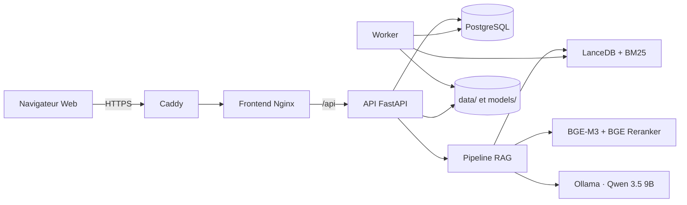

# LISA · RAG ENSEA

Assistant conversationnel documentaire local pour l’ENSEA d’Abidjan.

LISA — **Laboratoire d’Innovation Numérique en Statistique Appliquée** — est une
application RAG multi-utilisateur capable de répondre à partir de plusieurs
corpus contrôlés, de citer les passages utilisés et de conserver de véritables
conversations. Elle comprend aussi une console d’administration pour gérer les
utilisateurs, les documents, les collectes, les chunks, les embeddings, les
index et les performances.

Le système peut fonctionner sur **CPU ou GPU NVIDIA**. Une fois les images,
modèles et index préparés, les conversations et le traitement des documents
locaux fonctionnent **sans connexion Internet**.

> Les collectes du Web, Facebook via Apify et l’envoi d’e-mails SMTP nécessitent
> naturellement un accès réseau. En mode hors ligne, ces fonctions sont
> désactivées proprement sans empêcher le reste de l’application de fonctionner.

## Où commencer ?

| Besoin | Documentation |
|---|---|
| Comprendre rapidement le projet | Le présent README |
| Comprendre tous les composants et les flux | [Architecture détaillée](docs/architecture.md) |
| Lancer Docker sur la machine locale | [Déploiement local](docs/deploiement_local.md) |
| Installer sur un serveur de test Linux | [Déploiement Linux](docs/deploiement_test.md) |
| Reproduire le RAG étape par étape | [Parcours des notebooks](notebooks/parcours_rag/README.md) |
| Comprendre les bibliothèques utilisées | [Dépendances](DEPENDENCIES.md) |
| Utiliser directement le notebook final | [Notebook `rag_ensea`](rag_ensea.ipynb) |

## Fonctionnalités principales

### Pour tous les utilisateurs

- création de compte, connexion, déconnexion et accès invité ;
- conversations multiples, privées et persistantes ;
- mémoire conversationnelle pour les questions de suivi ;
- réponses générées à partir des corpus disponibles ;
- citations numérotées avec titre, extrait et lien vers la source ;
- mode réflexion facultatif pour les demandes complexes ;
- historique, copie des réponses et retours « utile / à améliorer » ;
- ajout de documents PDF depuis l’interface ;
- interface responsive en français et en anglais, avec thèmes clair et sombre.

### Pour les administrateurs

- gestion des utilisateurs, rôles, sessions et accès invités ;
- supervision des conversations, latences, erreurs et feedbacks ;
- import des PDF locaux et suivi de leur indexation ;
- collecte du site institutionnel et des pages Facebook configurées ;
- programmation des collectes et traitements ;
- nettoyage, chunking, embeddings et reconstruction des index ;
- sélection du modèle de génération et du profil matériel ;
- suivi de la file des travaux et des journaux d’audit.

## Corpus documentaires

Le retriever route ou combine automatiquement trois familles d’index :

| Corpus | Contenu | Exemples de questions |
|---|---|---|
| Institutionnel | Sites officiels ENSEA, formations, admissions, gouvernance, recherche, vie associative et PDF associés | « Quelles sont les filières de l’ENSEA ? » |
| Économique | Rapports PDF et tableaux produits par l’ANSTAT ou d’autres institutions statistiques | « Quel était le rapport de masculinité en 2025 ? » |
| Facebook | Publications et texte extrait des images des pages ENSEA, clubs et associations | « Qui a remporté le concours ENSEA Éloquence ? » |

Les PDF ajoutés depuis l’application rejoignent la bibliothèque locale. Leurs
passages sont indexés sans supprimer les corpus déjà présents.

## Architecture générale



### Frontend

Le dossier `frontend/` contient une interface Web autonome en HTML, CSS et
JavaScript. Nginx sert les fichiers et transmet uniquement les routes `/api` au
backend. Aucun mot de passe, jeton Apify ou secret de base de données n’est
présent dans le navigateur.

### API

Le dossier `backend/` contient l’API FastAPI. Elle gère l’authentification, les
autorisations, les conversations, les documents, les tâches administratives et
le streaming des réponses. Le pipeline RAG est chargé paresseusement au premier
message documentaire afin de garder les opérations d’identité légères.

### Worker

Le worker exécute les opérations longues en dehors du serveur Web : import PDF,
collecte, OCR, nettoyage, chunking, embeddings et indexation. Une seule opération
lourde est exécutée à la fois afin de protéger les index et la mémoire disponible.

### PostgreSQL

PostgreSQL conserve les comptes, rôles, sessions, conversations, messages,
feedbacks, tâches, planifications et événements d’audit. SQLite reste utilisable
pour l’ancien lancement Python local, mais Docker utilise PostgreSQL.

### Ollama et les modèles RAG

- **Qwen 3.5 9B** produit les réponses. Il offre un meilleur raisonnement et une
  meilleure compréhension du contexte que les petits modèles précédemment
  testés, tout en restant exécutable localement avec Ollama.
- **BAAI/bge-m3** calcule des embeddings multilingues de 1 024 dimensions. Il est
  particulièrement adapté aux contenus français, aux requêtes sémantiques et
  aux corpus hétérogènes.
- **BAAI/bge-reranker-v2-m3** relit conjointement la question et les meilleurs
  passages afin de corriger l’ordre obtenu par la recherche initiale.
- **LanceDB** stocke les vecteurs localement, sans serveur vectoriel séparé.
- **BM25** conserve un canal lexical robuste pour les noms, sigles, nombres et
  formulations exactes.

Le même code fonctionne sur GPU ou CPU. Sur CPU, Qwen et les modèles BGE sont
plus lents, mais aucune fonctionnalité documentaire n’est supprimée.

## Parcours d’une question

1. La question est contextualisée avec les tours utiles de la conversation.
2. Le routeur choisit les corpus institutionnel, économique, Facebook ou une
   combinaison de ceux-ci.
3. BGE-M3 calcule l’embedding de la requête.
4. LanceDB effectue la recherche dense et BM25 la recherche lexicale.
5. Un canal structuré recherche directement les faits extraits des tableaux.
6. RRF fusionne les classements ; MMR limite les passages redondants.
7. BGE Reranker réordonne les candidats avec la question complète.
8. Le générateur construit un prompt respectant le budget de contexte.
9. Qwen génère la réponse en streaming avec des références `[1]`, `[2]`, etc.
10. L’API sauvegarde le message, les citations et les métriques de performance.

## Parcours d’un document

```text
Source Web, Facebook, PDF ou tableur
    → extraction du texte et des tableaux
    → nettoyage et déduplication
    → chunks parent-enfant et faits tabulaires atomiques
    → embeddings BGE-M3
    → index dense LanceDB + index lexical BM25
    → retrieval, reranking et génération citée
```

Les faits tabulaires conservent autant que possible : indicateur, valeur, unité,
période, territoire, type de mesure, document et numéro de page. Des contrôles
rejettent les lignes manifestement corrompues avant l’indexation.

## Démarrage recommandé avec Docker

Docker est la méthode recommandée pour utiliser l’application complète. Elle
reproduit l’architecture du serveur de test et évite de mélanger les dépendances
du poste avec celles de LISA.

### Sur la machine locale

Installer Docker Desktop, puis suivre intégralement le
[guide de déploiement local](docs/deploiement_local.md).

Après la préparation initiale des modèles, le lancement CPU se fait avec :

```powershell
.\deployment\local\start.ps1 -Profile cpu
```

L’application est ensuite disponible sur
[http://localhost:8080](http://localhost:8080).

Pour l’arrêter sans supprimer les comptes ni les index :

```powershell
.\deployment\local\stop.ps1 -Profile cpu
```

### Sur le serveur Linux

Le serveur de test utilise uniquement des conteneurs Linux. Les prérequis,
commandes d’installation, secrets, certificats, profils CPU/GPU et procédures
hors ligne sont détaillés dans le
[guide de déploiement Linux](docs/deploiement_test.md).

Profil CPU :

```bash
deployment/linux/start.sh cpu offline
```

Profil NVIDIA :

```bash
deployment/linux/start.sh gpu offline
```

## Fonctionnement hors ligne

L’exploitation hors ligne repose sur trois ensembles persistants :

- les images Docker de l’application et de ses services ;
- les modèles dans `models/huggingface/` et `models/ollama/` ;
- les sources, chunks, embeddings et index dans `data/`.

Les scripts de `deployment/linux/` permettent de télécharger ces éléments sur
une machine connectée, de produire un paquet avec empreintes SHA-256, puis de le
transférer vers un serveur sans Internet.

En exploitation :

- `HF_HUB_OFFLINE=1` et `TRANSFORMERS_OFFLINE=1` empêchent les téléchargements
  implicites de modèles BGE ;
- `OLLAMA_NO_CLOUD=1` désactive les fonctions cloud d’Ollama ;
- `RAG_OFFLINE_MODE=1` bloque les collectes réseau et leur planification ;
- les PDF locaux, embeddings, index, conversations et réponses continuent de
  fonctionner normalement.

Le dépôt Git seul ne contient pas les modèles ni les corpus volumineux. Pour
déployer une instance déjà indexée, il faut donc transférer séparément `data/`
et `models/`, ou utiliser le paquet hors ligne décrit dans le guide Linux.

## Ancien lancement Python pour le développement

Cette méthode reste utile pour les notebooks et le diagnostic du pipeline, mais
ne remplace pas l’architecture Docker multi-utilisateur.

Prérequis : Python 3.11, l’environnement `.venv` et Ollama lancé localement.

```powershell
.\.venv\Scripts\Activate.ps1
pip install -r requirements.txt
ollama pull qwen3.5:9b
.\.venv\Scripts\python.exe run_app.py
```

Ouvrir ensuite [http://127.0.0.1:8000](http://127.0.0.1:8000).

Le fichier `start_app.bat` fournit le même lancement sous Windows. Il utilise
explicitement `.venv` et ne se replie pas sur le Python global.

## Ajouter un PDF depuis l’application

1. Ouvrir **Documents** ou utiliser le bouton `+` de la zone de saisie.
2. Choisir un PDF de 50 Mo maximum.
3. Compléter éventuellement le titre, l’auteur, la date et la catégorie.
4. Cliquer sur **Ajouter et indexer**.
5. Attendre le statut **Prêt** avant d’interroger le document.

Le worker extrait le texte page par page, crée les chunks, calcule les nouveaux
embeddings et met à jour les index. Un PDF scanné sans texte exploitable doit
passer par un OCR.

## Notebooks et expérimentation

Le dossier `notebooks/parcours_rag/` reprend toutes les étapes dans l’ordre :

| Notebook | Étape |
|---|---|
| `00_PARCOURS_RAG` | carte générale du pipeline |
| `01_collecte_institutionnelle` | pages et PDF des sites ENSEA |
| `02_collecte_facebook` | publications des pages configurées |
| `03_import_pdf_eco_rci` | rapports économiques locaux |
| `04_nettoyage_et_qualite` | normalisation, tableaux et contrôles qualité |
| `05_chunking_parent_enfant` | passages narratifs et faits atomiques |
| `06_embeddings_bge_m3` | encodage dense des trois corpus |
| `07_indexation_lancedb_bm25` | construction LanceDB et BM25 |
| `08_retrieval_hybride_et_reranking` | routage, fusion, MMR et reranking |
| `09_generation_citations_et_conversation` | génération et mémoire conversationnelle |
| `10_evaluation_retrieval_et_generation` | métriques et golden sets |
| `11_observabilite` | latences, erreurs et requêtes lentes |
| `12_ajout_pdf_et_index_incremental` | ajout et mise à jour incrémentale |
| `13_rag_ensea_end_to_end` | validation complète |

Le dossier `notebooks/test&comparisons/` contient les benchmarks, audits et
comparaisons expérimentales. Il ne doit pas être considéré comme le parcours de
production.

## Configuration

[`config.yaml`](config.yaml) centralise les paramètres fonctionnels du RAG :

- sources et pages Facebook ;
- tailles et chevauchement des chunks ;
- modèles d’embedding, reranking et génération ;
- top-k, seuils, poids RRF et paramètres MMR ;
- budgets de contexte et de génération ;
- profils de performance et chemins des index ;
- golden sets et observabilité.

Les secrets et paramètres propres au déploiement ne sont pas placés dans
`config.yaml`. Ils viennent de `.env.local` ou `.env.test`, ainsi que des fichiers
montés depuis `secrets/`.

## Organisation des fichiers

```text
RAG ENSEA/
├── frontend/                       interface HTML/CSS/JavaScript responsive
├── backend/                        API, sécurité, base, worker et administration
│   ├── main.py                     routes FastAPI et contrôles d’accès
│   ├── database.py                 PostgreSQL/SQLite et migrations additives
│   ├── security.py                 Argon2id, sessions, cookies et CSRF
│   ├── rag_service.py              chargement unique et profils CPU/GPU
│   ├── admin_service.py            file de travaux et planificateur
│   └── worker.py                   exécution des traitements longs
├── src/                            composants du pipeline RAG
│   ├── scraper.py                  collecte institutionnelle
│   ├── facebook_scraper.py         collecte Apify des publications
│   ├── local_documents.py          import des PDF locaux
│   ├── cleaner.py                  nettoyage et déduplication
│   ├── table_facts.py              extraction des faits de tableaux
│   ├── chunker.py                  chunks parent-enfant
│   ├── embeddings.py               BGE-M3
│   ├── vectorstore.py              LanceDB, BM25 et index incrémental
│   ├── source_router.py            décision des corpus à interroger
│   ├── routed_retriever.py         combinaison de plusieurs corpus
│   ├── retriever.py                RRF, MMR et BGE Reranker
│   ├── conversation.py             contexte et mémoire des échanges
│   ├── generator.py                prompt, Ollama, streaming et citations
│   ├── rag_pipeline.py             façade de haut niveau
│   ├── maintenance.py              reconstruction hors notebook
│   ├── evaluation.py               métriques et évaluations
│   └── observability.py            traces structurées et rotation
├── notebooks/
│   ├── parcours_rag/               construction reproductible, étapes 00 à 13
│   └── test&comparisons/           audits et expériences
├── scripts/                         construction des assets et tâches admin
├── tests/                           tests unitaires et contrats statiques
├── docs/
│   ├── architecture.md              architecture détaillée
│   ├── deploiement_local.md         Docker Desktop local
│   └── deploiement_test.md          serveur Linux, CPU/GPU et hors ligne
├── deployment/
│   ├── linux/                       préparation et validation hors ligne
│   ├── nginx.conf                   frontend et reverse proxy API
│   ├── Caddyfile                    HTTPS public
│   └── Caddyfile.offline            HTTPS avec certificat fourni
├── data/                             corpus, chunks, index et état applicatif
├── models/                           caches BGE et Ollama, non versionnés
├── secrets/                          secrets Docker, non versionnés
├── compose.test.yaml                 pile portable CPU par défaut
├── compose.gpu.yaml                  extension NVIDIA facultative
├── compose.tls.yaml                  HTTPS public automatique
├── compose.tls.offline.yaml          HTTPS avec certificat local
├── Dockerfile.backend
├── Dockerfile.frontend
├── config.yaml
├── requirements.txt
├── requirements-server.txt
├── rag_ensea.ipynb
└── README.md
```

### Contenu persistant de `data/`

```text
data/
├── raw/                  collecte institutionnelle brute
├── pdf/                  PDF institutionnels téléchargés
├── sources/              documents économiques et autres originaux
├── cleaned/              textes normalisés
├── chunks/               chunks institutionnels
├── embeddings/           vecteurs et index institutionnels
├── economic/             chunks, vecteurs et index économiques
├── facebook/             collecte, OCR, chunks, vecteurs et index Facebook
├── uploads/              PDF ajoutés depuis l’application
├── app/                  état SQLite local et verrous
├── golden_sets/          jeux d’évaluation
├── evaluation_runs/      résultats des évaluations
└── observability/        traces et métriques locales
```

## Sécurité

- mots de passe dérivés avec Argon2id ;
- cookie de session opaque, `HttpOnly` et `Secure` en HTTPS ;
- protection CSRF sur les écritures ;
- sessions enregistrées côté serveur et révocables ;
- contrôle des rôles utilisateur/administrateur sur chaque route sensible ;
- secrets Docker montés depuis des fichiers, jamais envoyés au frontend ;
- hôtes et origines explicitement autorisés ;
- PostgreSQL, API, worker et Ollama non exposés publiquement ;
- premier compte créé administrateur, comptes suivants utilisateurs ordinaires ;
- journal d’audit pour les opérations administratives.

Avant toute exposition publique, vérifier HTTPS, SMTP, sauvegardes, restauration,
rotation des secrets, pare-feu et supervision en suivant le guide Linux. Les
signalements privés et la conduite à tenir en cas de fuite sont décrits dans
[`SECURITY.md`](SECURITY.md).

## Tests

Depuis l’environnement virtuel du projet :

```powershell
$env:PYTHONPATH = "$PWD;$PWD\src"
.\.venv\Scripts\python.exe -m unittest discover -s tests -v
```

La suite couvre notamment :

- isolation des conversations et cycle des comptes ;
- routage institutionnel, économique et Facebook ;
- mémoire conversationnelle ;
- extraction et retrieval des faits tabulaires ;
- métriques d’évaluation ;
- contrat frontend/backend ;
- profils CPU/GPU et préparation hors ligne.

État au moment de cette documentation : **104 tests réussis**.

## Métriques d’évaluation

Les notebooks calculent notamment :

- `Recall@k` : proportion des sources pertinentes retrouvées ;
- `Precision@k` : proportion de résultats pertinents parmi les résultats rendus ;
- `Hit Rate@k` : présence d’au moins une source pertinente dans les `k` premiers ;
- `MRR` : rang moyen réciproque de la première bonne source ;
- latence moyenne, médiane, P95 et maximum ;
- qualité des citations, couverture factuelle et abstention ;
- temps de retrieval, génération, premier token et débit en tokens par seconde.

Les golden sets historiques et étendus se trouvent dans `data/` lorsqu’ils sont
présents dans la copie de travail.

## Préparer un futur dépôt Git

Le fichier [`.gitignore`](.gitignore) exclut les éléments locaux ou sensibles :

- `.venv/`, caches Python et fichiers temporaires ;
- `.env.local`, `.env.test` et autres environnements réels ;
- `secrets/`, certificats privés et jetons ;
- `models/`, images exportées et paquets hors ligne ;
- corpus, PDF, tableurs, embeddings, index, bases et traces ;
- sauvegardes et rapports générés.

Les fichiers `.env.local.example` et `.env.test.example` restent versionnables,
car ils ne contiennent que des valeurs d’exemple.

Les règles de contribution et les contrôles obligatoires avant un commit sont
décrits dans [`CONTRIBUTING.md`](CONTRIBUTING.md).

Avant le premier commit :

```bash
git init
git status --short
git add .
git status --short
```

Examiner attentivement la deuxième sortie avant de créer le commit. Aucun fichier
de `secrets/`, aucun `.env.local`/`.env.test`, aucun modèle et aucun document réel
ne doit apparaître.

Puis, seulement après cette vérification :

```bash
git commit -m "Initialisation de LISA RAG ENSEA"
```

Il est recommandé d’utiliser Git LFS uniquement si certains modèles, corpus ou
rapports doivent réellement être partagés par Git. Par défaut, le transfert
séparé de `data/` et `models/` est plus sûr et plus adapté.

### Dépôt privé ou public

Avant de rendre le dépôt public, valider avec l’ENSEA :

- le droit de republier les logos et autres éléments de marque ;
- la licence à appliquer au code ;
- le statut des jeux de questions et documents d’évaluation ;
- les éventuelles données personnelles présentes dans les notebooks ou exemples.

Aucun fichier `LICENSE` n’est actuellement défini. Tant qu’une licence n’a pas
été choisie explicitement, un visiteur ne dispose pas automatiquement du droit
de réutiliser, modifier ou redistribuer le code. Pour commencer sans risque, il
est préférable de créer le dépôt en mode privé puis d’effectuer cette revue avant
une publication éventuelle.

## Limites et précautions

- Une réponse RAG dépend de la qualité et de l’actualité des documents indexés.
- L’OCR de publications ou PDF très bruités peut produire des noms incorrects ;
  le système applique des garde-fous, mais la source doit toujours être vérifiée.
- Le mode réflexion augmente sensiblement le temps de réponse.
- Qwen 9B sur CPU est fonctionnel mais beaucoup plus lent que sur GPU.
- Les collectes Facebook dépendent d’Apify et de la structure des pages externes.
- Un dépôt fraîchement cloné ne possède ni les modèles ni les corpus privés ; il
  faut suivre la préparation initiale ou restaurer un paquet hors ligne.

## Commandes utiles

État des conteneurs :

```bash
deployment/linux/status.sh
```

Journaux principaux :

```bash
deployment/linux/status.sh --follow
```

Validation de la préparation hors ligne sous Linux :

```bash
deployment/linux/verify_offline_ready.sh .env.test
```

Sauvegarde, restauration, HTTPS et diagnostics complets sont documentés dans
[docs/deploiement_test.md](docs/deploiement_test.md).
