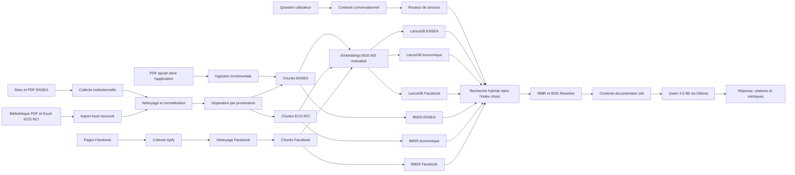
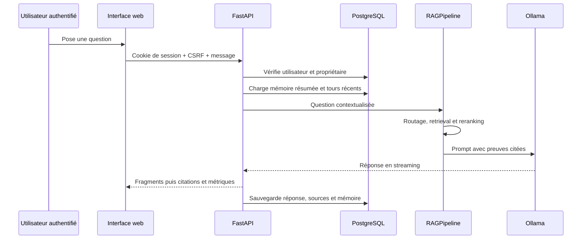
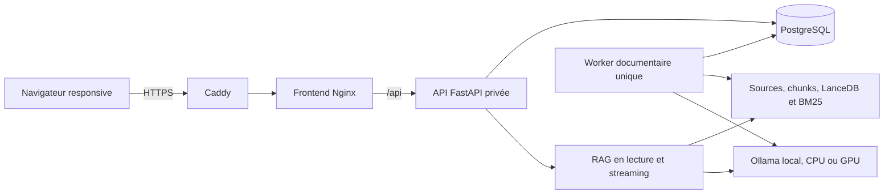

# Architecture de LISA / RAG ENSEA

Ce document décrit le système tel qu'il fonctionne actuellement. Il peut être lu indépendamment des notebooks : il présente les sources de données, la construction des index, le traitement d'une question, l'application web, l'évaluation et les mises à jour.

## 1. Objectif du système

Le RAG ENSEA est un assistant documentaire local. Il répond aux questions sur l'ENSEA et peut désormais exploiter une bibliothèque économique de Côte d'Ivoire. Les preuves proviennent de quatre familles de sources :

- les pages et PDF des sites institutionnels de l'ENSEA ;
- les publications Facebook de l'école, de ses clubs et associations ;
- les PDF et classeurs Excel économiques locaux provenant de l'ANSTAT et d'autres institutions ;
- les PDF ajoutés par un utilisateur depuis l'application.

Le modèle ne constitue pas la base de connaissances. Les connaissances se trouvent dans les documents indexés. Le modèle sert à rédiger une réponse à partir des passages retrouvés et à leur associer des citations vérifiables.

Le système est portable : le profil `cpu_only` fonctionne sans carte graphique,
tandis que les profils GPU accélèrent l’embedding, le reranking ou la
génération lorsqu’un GPU NVIDIA est disponible. Le profil
`generation_priority_8gb` est optimisé pour une RTX 5060 Laptop de 8 Go et un
Ryzen 7 8745HX. Dans tous les profils, les modèles restent locaux, la fenêtre de
contexte est bornée et les traitements lourds sont isolés du serveur web.

## 2. Vue d'ensemble



Le système possède deux temps de fonctionnement distincts :

1. **L'ingestion**, exécutée lorsqu'une source est collectée, corrigée ou ajoutée.
2. **La réponse**, exécutée à chaque question et optimisée pour rester rapide.

L'évaluation et l'observabilité entourent ces deux chaînes sans les remplacer.

## 3. Couche de données

### 3.1 Sources institutionnelles

`src/scraper.py` découvre les URL à partir du sitemap officiel, puis utilise Crawlee et BeautifulSoup pour parcourir les pages. Le collecteur conserve le texte, la structure des titres, les listes, tableaux, liens, dates, métadonnées et fil d'Ariane. Les PDF liés sont téléchargés et leur texte est extrait avec pypdf, avec pdfplumber en solution de repli.

Les sorties sont séparées :

- `data/raw/` contient les enregistrements JSON bruts ;
- `data/pdf/` contient les PDF institutionnels originaux ;
- `data/cleaned/` contient les documents Markdown nettoyés.

Les volumes évoluent à chaque collecte. Les notebooks et la page Outils lisent
les compteurs dans les artefacts actifs au lieu de dépendre de nombres inscrits
dans cette documentation. Le nombre brut peut être supérieur au nombre de
documents nettoyés, car il inclut plusieurs représentations de collecte et les
enregistrements issus des PDF.

### 3.2 Publications Facebook

`src/facebook_scraper.py` utilise l'Actor Apify configuré pour récupérer les publications des huit pages déclarées dans `config.yaml`. Le jeton Apify n'est jamais stocké dans le dépôt.

`src/facebook_processor.py` normalise Unicode, dates, permaliens et noms de pages, retire les textes trop courts et déduplique le contenu. Facebook reste dans un index séparé, car une publication sociale est plus datée et moins institutionnelle qu'une page officielle.

Après préparation et reconstruction, les publications, chunks, embeddings et
index Facebook sont écrits dans `data/facebook/`. Leur nombre dépend des pages,
de la limite choisie dans l’administration, de la déduplication et du dernier
succès de collecte.

### 3.3 Bibliothèque économique ECO RCI

Les documents originaux sont conservés dans `data/sources/eco_rci/`, avec leurs
sous-dossiers `ANSTAT` et `AUTRES_INSTITUTIONS`. PDF et classeurs Excel peuvent
être ajoutés à cette bibliothèque ; l’import calcule leur empreinte et réutilise
les documents inchangés.

`src/local_documents.py` parcourt les PDF et les classeurs XLSX/XLSM, calcule leur empreinte et produit des enregistrements régénérables `local_pdf_*.json` et `local_sheet_*.json` dans `data/raw/`. Les originaux ne sont jamais modifiés. Pour les PDF, le texte et les tableaux sont extraits page par page ; les pages paysages tournées sont remises dans leur repère logique avant lecture. Pour Excel, chaque feuille est segmentée quand un nouvel en-tête temporel commence afin d'éviter de mélanger deux tableaux successifs.

`src/table_facts.py` transforme chaque cellule statistique exploitable en fait autonome : `indicateur + valeur + unité + période + territoire + type de mesure + page ou feuille`. Une cellule vide ne décale donc plus les valeurs vers l'année voisine. La validation structurelle rejette les lignes mal formées, les valeurs mal groupées, les unités contaminées, les libellés narratifs anormalement longs, les périodes aberrantes et les contradictions entre cellules avant le chunking et les embeddings.

Les citations utilisent `/api/source-files/...`, une route contrôlée par FastAPI qui ouvre le PDF ou le classeur original sans exposer le reste du disque. Les documents économiques passent par le même nettoyage et le même chunking hiérarchique, mais leurs chunks sont ensuite isolés dans `data/economic/`. Cette séparation empêche un long rapport statistique de faire reculer une page ENSEA pertinente dans les résultats institutionnels.

### 3.4 PDF ajoutés depuis l'application

`backend/document_service.py` gère les PDF téléversés. Il vérifie le type, la taille et l'empreinte SHA-256, extrait le texte page par page, produit les mêmes chunks structurés que le corpus principal et calcule seulement les nouveaux embeddings.

Les fichiers originaux et leurs chunks sont placés dans :

- `data/uploads/pdfs/` ;
- `data/uploads/chunks/`.

Un PDF scanné sans couche texte est refusé proprement : un OCR doit être appliqué avant son import.

## 4. Préparation documentaire

### 4.1 Nettoyage

`src/cleaner.py` transforme les données brutes en Markdown. Trafilatura et les règles ciblées pour WordPress retirent menus, en-têtes, pieds de page, barres latérales et blocs répétés. Une déduplication globale supprime également le boilerplate commun à une grande partie des pages. Les listes HTML conservées par le scraper sont restaurées sous forme de puces Markdown distinctes : une liste d'associations ne peut ainsi plus fusionner avec une liste voisine de guides, politiques ou ressources.

Le Markdown conserve les titres et les métadonnées. Les faits tabulaires sont transportés séparément dans le front-matter : le nettoyage narratif ne peut ni casser leur relation avec l'année ni leur faire perdre leur page. Cette structure est importante pour produire des chunks cohérents et pour afficher des citations avec un titre, une section, une page et une URL.

### 4.2 Chunking parent-enfant

`src/chunker.py` applique une stratégie hiérarchique :

1. séparation selon les titres Markdown ;
2. découpage récursif des sections trop longues ;
3. chevauchement de 15 % entre enfants voisins ;
4. liaison de chaque enfant à un parent plus large.

Le **chunk enfant**, ciblé autour de 400 tokens, est utilisé pour la recherche : sa petite taille rend l'embedding plus précis. Le **parent**, limité autour de 1 800 tokens, apporte au générateur le contexte qui entoure le passage pertinent.

Trois types de chunks coexistent :

- `text` pour les paragraphes et listes ordinaires ;
- `table_fact` pour une cellule statistique exacte. Son enfant contient explicitement l'indicateur, la période, la valeur, l'unité, le territoire, le type de mesure, la page ou la feuille et le domaine ; son parent rassemble toute la série temporelle de la même ligne. Le retriever peut ainsi viser `Population homme — 2025 — 17 103 895`, tandis que le générateur reçoit également les années voisines sans devoir reconstruire le tableau aplati ;
- `derived_fact` pour un calcul déterministe et traçable. Le système peut additionner quatre flux trimestriels compatibles ou calculer une variation entre deux trimestres successifs. La formule, les opérandes et leur provenance restent dans le parent ; les taux, ratios, stocks et lignes ambiguës ne sont jamais additionnés automatiquement.

Les sorties actives restent séparées : `data/chunks/chunks.jsonl` contient les
chunks institutionnels ENSEA, `data/economic/chunks.jsonl` les chunks ECO RCI,
et `data/facebook/` le corpus social. Une reconstruction remplace les artefacts
de sortie, mais ne supprime jamais les originaux de `data/sources/`.

### 4.3 Embeddings BGE-M3

`src/embeddings.py` utilise `BAAI/bge-m3`. Ce modèle produit des vecteurs
normalisés de 1 024 dimensions. Il utilise FP16 avec CUDA lorsqu’un profil GPU
est actif et une précision compatible CPU dans le profil `cpu_only`.

Ses avantages dans ce projet sont :

- une bonne compréhension du français et des contenus multilingues ;
- une meilleure reconnaissance sémantique que la recherche par mots exacts ;
- un contexte d'encodage long ;
- un compromis précision/mémoire compatible avec les profils CPU et GPU.

Un embedding rapproche des formulations de sens voisin, mais il n'est pas idéal pour tous les sigles, noms propres ou numéros. C'est la raison pour laquelle il est complété par BM25.

## 5. Indexation

### 5.1 LanceDB : index dense

`src/vectorstore.py` stocke les vecteurs dans LanceDB, une base embarquée qui ne nécessite aucun serveur. Chaque vecteur reste lié à ses métadonnées : identifiant du chunk, parent, titre, section, URL et texte. Le schéma contient aussi `content_type`, `page`, `table_id`, `row_id`, `indicator`, `period`, `value`, `unit`, `territory`, `measure_type`, `qualifier`, `domain` et `source_method`. Un ancien index reste lisible, mais la reconstruction du notebook 07 le migre vers ce schéma complet.

L'index institutionnel actif se trouve dans `data/embeddings/lancedb/`, l'index économique dans `data/economic/lancedb/` et l'index Facebook dans `data/facebook/lancedb/`. Chaque index dense recherche les passages sémantiquement proches de la question dans sa propre famille de sources.

### 5.2 BM25 : index lexical

BM25 indexe les termes présents dans les titres, sections et textes. Pour un fait tabulaire, il indexe aussi l'indicateur, la période, la valeur normalisée, l'unité, le territoire, le type de mesure, le qualificatif et le domaine. Il est très efficace pour les correspondances exactes : `ISE`, un nom de personne, un acronyme, un intitulé de formation, une année ou une expression rare.

Son tokenizer normalise également les accents et les pluriels simples. Ainsi, `finalistes` peut retrouver `finaliste`, `laboratoires` retrouve `laboratoire` et `admissions` retrouve `admission`.

Les index lexicaux actifs se trouvent dans `data/embeddings/bm25_index.pkl`, `data/economic/bm25_index.pkl` et `data/facebook/bm25_index.pkl`.

### 5.3 Mise à jour incrémentale

`VectorStoreManager.sync_incremental` compare les empreintes des chunks par URL. Les vecteurs inchangés sont réutilisés, les anciens chunks d'une source modifiée sont retirés et seuls les nouveaux chunks sont encodés. BM25 est ensuite reconstruit, opération peu coûteuse sur ce volume.

Cette conception permet d'ajouter un rapport PDF ou de mettre à jour une page sans recalculer les milliers de vecteurs existants.

## 6. Traitement d'une question

### 6.1 Conversation et demande exhaustive

`src/conversation.py` détecte les relances comme « la liste est-elle exhaustive ? », « qui l'a précédé ? », « et avant lui ? » ou « développe le deuxième point ». La dernière question utilisateur autonome est ajoutée à la requête de recherche. Un court ancrage extrait de la dernière réponse substantielle — par exemple le nom de la personne résolue au tour précédent — enrichit aussi la recherche, sans devenir une preuve. Les nouveaux faits doivent toujours provenir des passages récupérés et cités.

Les salutations, remerciements, acquiescements, départs et demandes simples sur les capacités de l'assistant suivent une route `conversation` immédiate. Ils ne chargent ni l'embedder, ni le reranker, ni Qwen. Ces tours sociaux ne remplacent pas le sujet actif, ne polluent pas la mémoire documentaire et ne donnent pas leur texte comme titre à la conversation. Une formulation mixte comme « merci, et qui l'a précédé ? » reste en revanche une véritable relance documentaire.

Une demande explicitement exhaustive, mais aussi une formulation qui demande naturellement une collection comme « quels sont les laboratoires ? », augmente le nombre maximal de résultats de 5 à 10. Elle ne force pas le système à inventer des éléments absents des sources.

Dans ce mode uniquement, le retriever ajoute un **rappel de couverture lexical**. Il repère automatiquement le nom de la collection recherchée dans des formulations courantes telles que « quels sont les X », « quelles sont les X », « liste des X » ou « tous les X ». Ce terme n'est pas codé pour un sujet particulier : il peut donc représenter des directeurs, laboratoires, accréditations, finalistes, partenaires ou toute autre catégorie. Les passages correspondants sont classés par BM25 puis ajoutés au lot du reranker. Lorsque la question contient aussi une relation — par exemple « a succédé », « associé à » ou « accrédité par » — le passage doit reprendre cette relation en plus de la catégorie avant de recevoir une place de couverture. Cette règle évite qu'un mot incident de l'historique force une page hors sujet.

Les inventaires généraux de clubs, associations et autres rattachements utilisent d'abord la source institutionnelle, qui fait autorité sur l'appartenance. Facebook reste interrogé pour une page explicitement nommée, une activité récente ou une publication sociale, mais une mention dans un post ne peut pas établir un rattachement.

Pour les questions d'appartenance, une validation relationnelle supplémentaire est injectée dans le prompt. Le modèle doit trouver une affirmation explicite de rattachement à l'organisation demandée. Une collaboration, un partenariat, une invitation, une participation, une mention ou un tag ne constituent pas une preuve d'appartenance. Le type d'entité est également conservé : un réseau d'alumni, un programme ou un centre ne peut pas être transformé en club. Lorsqu'une liste institutionnelle explicite et une publication sociale incidente coexistent, la liste institutionnelle fait autorité.

Le générateur combine trois protections contre les boucles : consigne explicite d'unicité, pénalité de répétition fournie à Ollama, puis filtre déterministe des puces identiques. En streaming, deux puces consécutives déjà produites interrompent la génération afin d'éviter une longue boucle visible et coûteuse.

Dans ce mode uniquement, le bassin dense et BM25 est élargi, MMR privilégie davantage la couverture et le filtre de similarité tolère des documents très proches qui peuvent représenter des éléments distincts d'une même liste. Le budget du prompt est ensuite réparti équitablement entre les résultats. Si un passage doit être raccourci, les phrases qui partagent le plus de concepts avec la question sont conservées avec leurs phrases voisines : le système ne prend plus mécaniquement le début du chunk au risque de couper les noms ou la relation utile. Les requêtes ordinaires conservent les réglages plus stricts validés par le benchmark.

Lorsqu'une demande de collection corrige une réponse précédente, le texte de cette ancienne réponse n'est pas renvoyé au générateur : seule la question utilisateur précédente est conservée si la relance est elliptique. Une question autonome comme « quels directeurs se sont succédé à l'ENSEA ? » ignore entièrement l'ancien échange. Le modèle reconstruit ainsi la liste depuis les documents plutôt que de répéter une omission conversationnelle.

### 6.2 Routage des sources

`src/source_router.py` et `src/routed_retriever.py` choisissent entre quatre routes :

- **institutional** pour les formations, admissions, dirigeants et contenus officiels ;
- **economic** pour les questions ANSTAT, PIB, inflation, RGPH, population, entreprises et autres statistiques économiques ;
- **facebook** pour les activités récentes de clubs ou d'associations ;
- **both** lorsque les deux familles peuvent contribuer.

Cette séparation évite qu'une publication sociale ou qu'un rapport économique très long ne remplace une source officielle sur une question institutionnelle. Une question ECO RCI est envoyée explicitement vers l'index économique ; le comportement ENSEA validé reste donc stable.

### 6.3 Recherche hybride

Pour chaque index sélectionné, `src/retriever.py` exécute :

1. un embedding de la question avec BGE-M3 ;
2. une recherche dense LanceDB, top 30 ;
3. une recherche lexicale BM25, top 30 ;
4. un canal structuré qui sélectionne l'indicateur puis la ou les périodes exactes dans les lignes tabulaires ;
5. une fusion RRF des rangs ;
6. l'identification des meilleurs documents, suivie d'une recherche de la meilleure page à l'intérieur de chacun d'eux ;
7. une déduplication par parent et par URL ;
8. une éventuelle proposition par correspondance de titre ;
9. une diversification MMR sur 15 candidats ;
10. un reranking final complété par les facettes structurées.

RRF combine les classements sans rendre directement comparables les scores hétérogènes de LanceDB et BM25. MMR réduit les passages quasi identiques et augmente la diversité des sources.

Pour `table_fact` et `derived_fact`, un bonus de facettes explicable complète le score : il récompense les périodes explicitement demandées, leur couverture complète et la compatibilité de l'indicateur, de l'unité, du territoire et du type de mesure. Une période demandée mais absente, ou une mesure incompatible, reçoit une pénalité. Les sigles PIB, IPPI, ICA et FBCF sont développés pour le canal structuré ; le score distingue un niveau absolu d'un taux ou d'une part, une valeur nominale d'un volume et un total d'une sous-population sexuée. Il mesure aussi la couverture du sujet précis de la question : une ligne générique « taux de croissance » ne peut donc plus passer devant « secteur primaire » lorsque ce secteur est demandé, et une question « combien d'élèves » privilégie un effectif plutôt qu'un ratio élèves/maître. Une année scolaire `2023-2024` privilégie la colonne 2024, alors qu'un intervalle ordinaire ne reçoit aucune interprétation arbitraire. Cette règle est générale et ne contient aucune réponse préprogrammée. Elle intervient dans la sélection avant et après le reranking, tandis que le cross-encoder continue de juger la pertinence sémantique du passage.

Sur une question numérique directe, le rang du canal structuré reste un petit signal de départ après le reranking : cela protège la cellule dont indicateur et période correspondent exactement, sans supprimer le jugement sémantique. Ce signal est désactivé pour les demandes comparatives. Dans ce second cas, le système privilégie le passage qui écrit réellement la relation demandée — par exemple « 1,8 % contre 7,2 % en situation de référence » — plutôt qu'une valeur annuelle isolée ou une autre prévision issue d'un document voisin.

Un troisième canal de rappel complète Dense et BM25 pour ces mêmes faits. Il indexe une fois chaque **ligne d'indicateur**, puis sélectionne dans cette ligne la cellule correspondant à la période explicite de la question. Cela empêche les milliers de variantes annuelles de saturer le top 30 avant le reranking. Dans une formulation comme « combien d'hommes… », le groupe placé après « combien de/d' » est traité comme la mesure recherchée, tandis que le pays reste un périmètre ; ce signal n'est accordé que si l'année ou la période correspond aussi. Une cellule portant la mauvaise période est pénalisée. Les cellules manifestement décalées ou corrompues par l'OCR sont exclues des trois bassins de candidats ; le passage textuel original demeure disponible, de sorte que le filtre ne supprime pas la source documentaire.

Une question qui demande plusieurs valeurs ou un calcul est d'abord décomposée en composantes structurées : indicateur(s), période(s), mesure attendue et opération. Le système recherche toutes les cellules nécessaires, au lieu d'espérer qu'un seul passage contienne déjà la réponse finale. Les sommes annuelles et variations trimestrielles sûres existent comme `derived_fact`. Une demande explicite de part ou de proportion recherche le numérateur et le dénominateur dans la **même source, la même page, la même période et la même échelle**, puis effectue le quotient de façon déterministe. Un rapprochement entre deux documents n'est autorisé que si la formulation demande explicitement de rapporter une grandeur à une autre et si période, unité et territoire sont compatibles. Le modèle reçoit le résultat et les opérandes traçables ; il ne choisit ni les nombres ni l'arithmétique.

### 6.4 BGE Reranker v2 M3

`BAAI/bge-reranker-v2-m3` relit chaque paire « question, passage ». Contrairement au bi-encodeur utilisé pour retrouver rapidement beaucoup de candidats, le cross-encoder analyse les deux textes ensemble. Il est plus lent, mais nettement plus précis pour ordonner une quinzaine de candidats.

Le système conserve normalement cinq passages finaux, avec au plus un résultat par URL et un filtre contre les pages quasi identiques. Un mécanisme de sauvetage lexical peut préserver le meilleur résultat BM25 lorsqu'il est très crédible.

## 7. Génération de la réponse

`src/generator.py` construit un prompt contenant la question, les passages retenus, leurs numéros de citation et un historique conversationnel strictement borné. Une preuve tabulaire affiche explicitement sa page, son indicateur, sa période, sa valeur et son unité ; le modèle reçoit alors l'instruction de reprendre la cellule exacte sans recalculer la valeur ni changer l'année. Il doit également distinguer réalisation, estimation et prévision, et ne peut pas déduire une période manquante depuis un trimestre ou une année voisine. Le retriever, lui, n'ajoute le contexte antérieur à sa requête que lorsqu'il détecte une véritable relance afin de ne pas polluer une nouvelle question indépendante.

Les labels compacts comme `3x Kaggle Master` sont détectés dans les preuves et transmis comme chaînes à conserver mot pour mot. Le modèle ne doit pas les convertir en nombre de victoires, de diplômes ou de mandats. Pour une comparaison chiffrée, une instruction locale lui impose de répondre avec le membre exact de la relation explicite et d'ignorer les valeurs concurrentes qui ne répondent pas à cette relation.

Le contexte est borné selon deux niveaux :

- jusqu'à 360 tokens sont réservés par preuve ordinaire afin de préserver plusieurs résultats pertinents ;
- sous une contrainte plus forte, une compression extractive conserve les phrases les plus proches de la question et leurs voisines au lieu de tronquer le début du passage ;
- le budget total du prompt est vérifié avant l'appel au modèle.

Le générateur est `qwen3.5:9b`, servi localement par Ollama avec :

- une fenêtre configurée à 6 144 tokens, retenue comme compromis entre contexte, mémoire et latence ;
- `thinking=false` par défaut pour préserver la rapidité sur les questions ordinaires ; le bouton **Réflexion** de la conversation active ponctuellement le raisonnement interne avec une réserve de 1 536 tokens ;
- une température de 0,1 pour favoriser la stabilité factuelle ;
- 192 tokens pour une valeur numérique simple, 320 pour un fait direct, 520 pour une explication et 640 pour une énumération ;
- la génération en streaming.

Qwen 3.5 9B améliore le raisonnement, la compréhension des consignes complexes
et la qualité rédactionnelle par rapport au modèle précédemment utilisé. Sa
quantification Ollama reste exploitable sur CPU et devient nettement plus
rapide avec un GPU compatible. Sa capacité multimodale pourra être exploitée
ultérieurement, mais le générateur actuel lui transmet uniquement du texte. Le
modèle ne décide pas seul des faits : il doit s’appuyer sur les preuves
numérotées fournies.

Le mode réflexion est un paramètre de chaque requête et non une propriété permanente du pipeline. L'API le transmet jusqu'au générateur Ollama et sépare les événements `reasoning` des événements `token` de la réponse finale. Le cache sépare strictement les réponses normales des réponses réfléchies et les métriques enregistrent le mode et le modèle effectivement utilisés.

Dans l'interface, la réflexion est présentée sous la forme d'un résumé animé pendant le calcul, puis d'un volet repliable qui permet de consulter la trace complète produite par le modèle. La base conserve cette trace dans des colonnes dédiées du message assistant afin qu'elle reste disponible après rechargement de la conversation. Elle demeure toutefois isolée du champ `content` : elle n'entre ni dans la mémoire conversationnelle envoyée au modèle, ni dans le retrieval, ni dans les citations.

La limite `num_predict` d'Ollama étant partagée entre la réflexion et la réponse, le générateur vérifie qu'au moins un fragment de réponse finale a été produit. Si Qwen termine sur une réflexion seule, une seconde passe sans réflexion reprend exactement le même prompt documentaire et produit uniquement la réponse finale. Cette récupération est enregistrée dans les métriques (`fallback_answer_used`, `reasoning_truncated`) et n'exécute pas une seconde recherche documentaire.

Un cache LRU exact évite une nouvelle génération lorsque question, contexte, historique, prompt et paramètres sont identiques. Une relance conversationnelle différente ne peut donc pas recevoir par erreur une ancienne réponse mise en cache.

## 8. Plateforme conversationnelle et administration

L'application n'est plus un simple écran placé devant le notebook. Elle est organisée comme une plateforme multi-utilisateur autour de FastAPI :

- `backend/main.py` expose l'API protégée, le streaming et les contrôles de rôle ;
- `backend/security.py` gère Argon2id, les sessions serveur révocables, leur expiration et les jetons CSRF ;
- `backend/database.py` conserve utilisateurs, conversations, mémoire, messages, citations, feedbacks, documents, planifications, tâches et audit ;
- `backend/rag_service.py` charge paresseusement un unique `RAGPipeline` et arbitre l’accès à la ressource de calcul, CPU ou GPU ;
- `backend/document_service.py` prépare les travaux d'ingestion PDF ;
- `backend/admin_service.py` soumet les travaux administratifs et surveille les planifications ;
- `backend/worker.py` exécute les traitements longs dans un processus séparé ;
- `src/maintenance.py` fournit les mêmes opérations reproductibles de nettoyage, chunking, embedding et indexation à la console et aux notebooks ;
- `frontend/` contient l'espace de conversation, l'authentification, les paramètres et la console administrateur.

Deux rôles existent :

- un **utilisateur** voit uniquement ses conversations, peut interroger les corpus, consulter les sources, gérer ses sessions et laisser un retour ;
- un **administrateur** dispose des mêmes fonctions, puis peut gérer les comptes, les PDF, les collectes, les chunks, les embeddings, les index, les modèles et les fréquences d'exécution.

Les conversations possèdent un propriétaire. Chaque requête vérifie cette propriété côté serveur ; masquer une conversation dans l'interface ne constitue jamais un contrôle d'accès. Les anciens historiques sont rattachés au premier administrateur lors de l'initialisation.



La mémoire conversationnelle comporte deux niveaux : les dix derniers messages détaillés et un résumé roulant borné pour les conversations longues. L'historique aide à comprendre les pronoms et les relances, mais ne devient jamais une preuve documentaire. Le retrieval reste fondé sur les sources indexées.

### 8.1 Profils de calcul et concurrence

Une seule génération ou opération d’indexation peut posséder la ressource
critique. Les demandes concurrentes sont sérialisées ; une maintenance lourde
est signalée avant la génération. `cpu_only` place tous les modèles sur le CPU.
`generation_priority_8gb` place l’embedder de requête et le reranker sur le CPU,
puis réserve la VRAM à Qwen. `balanced_gpu` permet de comparer une répartition
plus large sur CUDA. Les notebooks d’indexation utilisent le périphérique
autorisé par le profil actif.

Ollama garde le modèle chargé pendant trente minutes, traite le prompt par lots
et reçoit un plafond de sortie adapté au type de question. Un administrateur
peut changer le modèle et le profil, sous réserve que le modèle soit déjà
présent localement lorsque le mode hors ligne est actif.

### 8.2 Architecture applicative déployable

L'application n'est plus un serveur web monolithique qui exécute toutes les opérations dans le même processus. Elle adopte un **monolithe modulaire déployable** : les règles métier restent réunies dans un même projet pour éviter la complexité artificielle des microservices, mais les responsabilités opérationnelles sont isolées.



Le frontend se trouve dans `frontend/` et peut être servi ou mis en cache indépendamment. L'API de `backend/` est le seul point d'accès aux comptes, conversations, documents et opérations administratives. PostgreSQL contient les utilisateurs, sessions, conversations, journaux, planifications et la file atomique de travaux. Le worker séparé traite les collectes et reconstructions : une tâche longue ne bloque plus le serveur de conversations. LanceDB et BM25 restent sur le volume documentaire partagé avec le moteur RAG mono-machine.

SQLite demeure disponible pour certains tests ou outils historiques à un seul
processus. Les profils Docker local et serveur utilisent PostgreSQL. Un verrou
inter-processus protège le moteur RAG et les index ; un seul worker lourd est
lancé, quelle que soit la présence d’un GPU. Cette architecture permet
d’ajouter ultérieurement des instances API sans dupliquer inutilement le modèle
de génération en mémoire.

### 8.3 Identité, autorisations et sécurité

Trois parcours existent : premier administrateur, inscription utilisateur et accès invité temporaire. La récupération de mot de passe utilise un jeton aléatoire à durée courte, stocké uniquement sous forme de hash ; l'envoi SMTP ne révèle jamais si une adresse existe. Les mots de passe utilisent Argon2id et les anciens hashes PBKDF2 sont migrés à la prochaine connexion.

Les cookies de session sont opaques, `HttpOnly`, `SameSite=Strict` et `Secure` sous HTTPS. Les écritures exigent un jeton CSRF. Les contrôles d'accès sont appliqués côté API à chaque ressource : un utilisateur ne lit que ses conversations ; l'administration des comptes, collectes, modèles et index exige le rôle administrateur. Les sessions sont révocables par leur propriétaire ou par un administrateur, et les actions sensibles sont inscrites dans un journal d'audit.

Le reverse proxy est le seul service public. L'API, PostgreSQL, le worker et Ollama restent privés. La liste des hôtes et origines est explicite, la taille des requêtes est bornée, les endpoints d'authentification sont limités en fréquence et les réponses reçoivent CSP, HSTS, `nosniff` et une politique de référent restrictive. Les comptes invités et jetons expirés sont purgés automatiquement.

### 8.4 Travaux administratifs

Les collectes et reconstructions passent par une liste blanche de tâches. Un administrateur peut lancer la collecte institutionnelle, la collecte Facebook, l'import de la bibliothèque PDF locale, le nettoyage, le chunking, les embeddings ou l'indexation, puis créer une fréquence horaire, quotidienne, hebdomadaire ou mensuelle. Pour Facebook, l'interface transmet une liste validée de pages et une limite de 1 à 100 publications par page. En déploiement séparé, un jeton Apify saisi ponctuellement est chiffré par une clé d'infrastructure avant son passage dans la file PostgreSQL ; le payload renvoyé par l'API masque systématiquement les champs secrets. Les planifications et leur prochaine exécution survivent au redémarrage ; leur jeton durable est injecté dans le worker par l'environnement. Un seul worker traite la file afin d'empêcher deux reconstructions concurrentes de modifier les mêmes index. Lorsque `RAG_OFFLINE_MODE=1`, les tâches qui exigent Internet sont refusées avant leur mise en file ; l’import local, le nettoyage, le chunking, les embeddings et l’indexation restent disponibles.

## 9. Évaluation

`src/evaluation.py` et les notebooks de `notebooks/test&comparisons/` conservent les benchmarks ayant conduit aux réglages actuels.

Les principales métriques de retrieval sont :

- **Recall@k** : proportion des sources attendues retrouvées dans les k premiers résultats ;
- **Precision@k** : proportion des k résultats qui sont attendus ;
- **Hit Rate@k** : proportion des questions ayant au moins une bonne source dans le top k ;
- **MRR** : inverse du rang de la première bonne source, moyenné sur les questions ;
- **P50/P95** : latence habituelle et latence haute.

Pour les questions issues d'un tableau, le benchmark enregistre aussi le hit sur la page attendue, la présence d'un chunk `table_fact` ou `derived_fact` dans le top-k et un **score de couverture des faits de référence**. L'évaluateur partagé de `src/evaluation_metrics.py` normalise les formats numériques français, les unités et les variantes textuelles, accepte les réponses valides même si elles ne recopient pas mot pour mot la référence, mais rejette une valeur associée explicitement à une autre année ou à un autre indicateur. Pour une référence numérique courte, un contrôle de l'affirmation principale empêche qu'une bonne valeur glissée dans une digression valide une réponse principale erronée. L'évaluation des abstentions et celle des réponses factuelles sont séparées.

`scripts/rescore_banque_100_run.py` peut recalculer ces verdicts à partir d'un rapport existant, sans relancer le retrieval ni les 100 générations. Cela permet de corriger l'évaluateur indépendamment du RAG et de conserver des comparaisons fiables entre versions.

La génération est contrôlée sur la fidélité aux sources, la correction, la complétude, la qualité des citations, le comportement d'abstention et la qualité conversationnelle. L'abstention est détectée à partir de plusieurs formulations naturelles, et non d'une seule phrase figée.

Le parcours pédagogique complet se trouve dans `notebooks/parcours_rag/`. Il suit les étapes 00 à 13 sans mélanger les notebooks de démonstration avec les anciens essais comparatifs.

## 10. Observabilité

`src/observability.py` écrit des événements JSONL dans `data/observability/traces.jsonl`. Une trace peut contenir :

- la route choisie et sa justification ;
- le temps passé dans la file de génération et le temps jusqu'au premier token ;
- les durées d'embedding, LanceDB, BM25, MMR et reranking ;
- le budget et la taille du prompt ;
- le temps de génération et les tokens par seconde ;
- le nombre de citations et l'état du cache ;
- le statut ou l'erreur rencontrée.

Les réponses complètes ne sont pas journalisées par défaut. Les fichiers sont soumis à une rotation pour éviter une croissance illimitée.

## 11. Organisation des fichiers

```text
RAG ENSEA/
├── frontend/                    interface web autonome et responsive
├── backend/                     API, identité, PostgreSQL, worker et ingestion PDF
├── deployment/                  lancement Windows, Linux, Nginx, Caddy et hors ligne
├── compose.test.yaml            pile privée portable, CPU par défaut
├── compose.gpu.yaml             extension NVIDIA facultative
├── compose.tls.yaml             HTTPS public avec certificat automatique
├── compose.tls.offline.yaml     HTTPS avec certificat local
├── docs/
│   └── architecture.md          présent document autonome
├── notebooks/
│   ├── parcours_rag/            construction complète, étapes 00 à 13
│   └── test&comparisons/        benchmarks et historique expérimental
├── scripts/                     notebooks, évaluations et entrée des travaux administratifs
├── src/                         composants du pipeline RAG
├── tests/                       tests automatisés
├── data/
│   ├── raw/                     collecte institutionnelle brute
│   ├── pdf/                     PDF institutionnels
│   ├── sources/eco_rci/         originaux ANSTAT et autres institutions
│   ├── import_reports/          rapports d'import des sources locales
│   ├── cleaned/                 corpus Markdown nettoyé
│   ├── chunks/chunks.jsonl      chunks institutionnels ENSEA
│   ├── embeddings/              vecteurs et index ENSEA
│   ├── economic/                chunks, vecteurs et index ECO RCI
│   ├── facebook/                collecte, chunks, vecteurs et index social
│   ├── uploads/                 PDF ajoutés et chunks associés
│   ├── app/                     état local et compatibilité des outils historiques
│   ├── evaluation_runs/         résultats de benchmarks
│   └── observability/           traces d'exécution
├── config.yaml                  configuration centrale
├── models/                      caches Hugging Face et Ollama, non versionnés
├── secrets/                     clés et certificats locaux, non versionnés
├── rag_ensea.ipynb              notebook final d'utilisation
├── run_app.py                   point d'entrée Python de l'application
└── start_app.bat                lancement Windows avec l'environnement du projet
```

## 12. Dépendances entre modules

| Module | Responsabilité | Dépend principalement de |
|---|---|---|
| `scraper.py` | collecte institutionnelle | Crawlee, HTTPX, BeautifulSoup, pypdf |
| `facebook_scraper.py` | collecte sociale | Apify Client |
| `local_documents.py` | import des PDF et classeurs économiques locaux | pypdf, pdfplumber, openpyxl |
| `table_facts.py` | reconstruction indicateur–période–valeur–unité–territoire des tableaux | coordonnées pdfplumber et matrices Excel |
| `cleaner.py` | extraction du contenu utile | Trafilatura, BeautifulSoup |
| `chunker.py` | chunks parent-enfant | tokenizer et règles Markdown |
| `embeddings.py` | vecteurs de question et documents | BGE-M3, PyTorch CPU ou CUDA |
| `vectorstore.py` | LanceDB, BM25, synchronisation | LanceDB, rank-bm25 |
| `retriever.py` | recherche hybride et reranking | embeddings, index, BGE Reranker |
| `routed_retriever.py` | routage et fusion institutionnel/économique/Facebook | routeur et retrievers spécialisés |
| `conversation.py` | relances et demandes exhaustives | règles déterministes |
| `generator.py` | prompt, citations, cache et streaming | Ollama/Qwen3 |
| `rag_pipeline.py` | orchestration complète | tous les composants de réponse |
| `evaluation.py`, `evaluation_metrics.py` | métriques, golden set et requalification sans génération | pipeline et annotations |
| `observability.py` | traces et résumés | statistiques d'exécution |
| `maintenance.py` | nettoyage, chunks, embeddings et index hors notebook | composants d'ingestion |
| `backend/security.py` | comptes, Argon2id, sessions, CSRF et récupération | PostgreSQL ou SQLite local |
| `backend/admin_service.py` | soumission des travaux et planificateur | dépôt, scripts, verrou RAG |
| `backend/worker.py` | exécution isolée des collectes et indexations | file PostgreSQL et volume documentaire |
| `backend/middleware.py` | hôtes, CORS, limites, en-têtes et requêtes intersites | configuration serveur |

## 13. Principes à préserver lors des évolutions

1. Ne jamais mélanger directement les publications sociales et les sources officielles sans routage.
2. Conserver URL, titre, section et provenance sur chaque chunk.
3. Évaluer toute modification du retrieval sur le golden set complet, pas sur une seule question.
4. Écrire les essais dans `data/experiments/` et ne remplacer un index actif qu'après validation.
5. Utiliser l'indexation incrémentale pour les ajouts de documents.
6. Garder la fenêtre Ollama compatible avec le profil matériel sélectionné et tester le profil CPU.
7. Ne jamais utiliser l'historique conversationnel comme preuve documentaire.
8. Conserver les notebooks de benchmark comme trace des décisions, mais retirer leurs gros artefacts une fois la solution validée.
